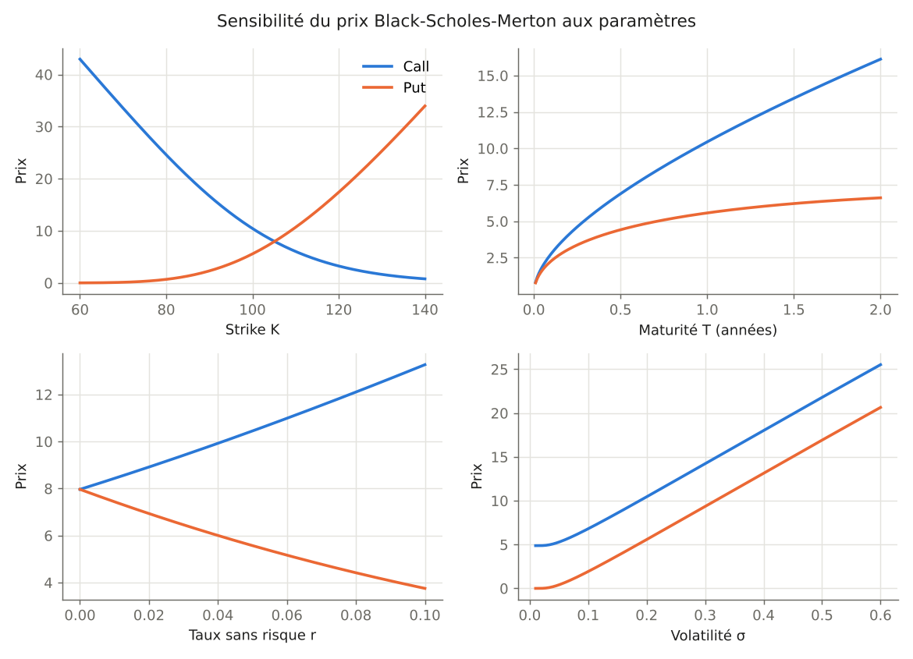
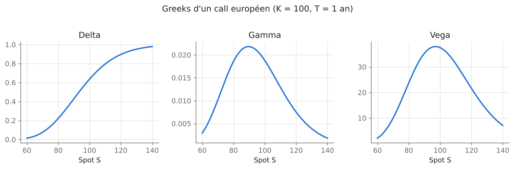
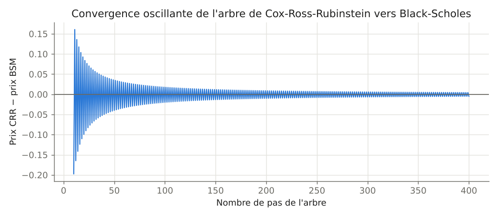
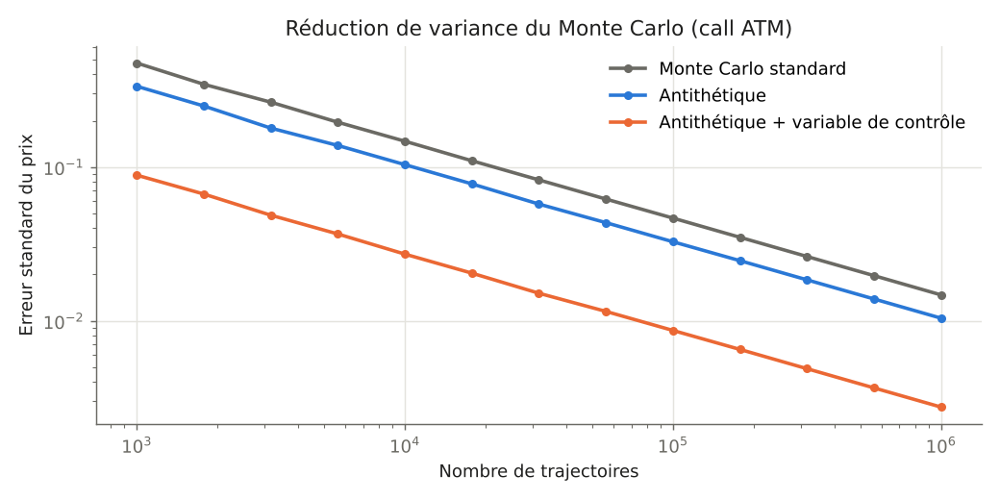

# Option Pricing Lab

Pricing d'options européennes et américaines en **Python** et en **C++** : formule fermée de Black-Scholes-Merton, Greeks, volatilité implicite, arbre binomial de Cox-Ross-Rubinstein et Monte Carlo avec réduction de variance.

Le projet part d'une implémentation pédagogique classique de Black-Scholes, où la loi normale est calculée par intégration numérique et où l'on boucle option par option. Il la réécrit en version vectorisée, testée et mesurée, puis compare avec un pricer Monte Carlo en C++ parallélisé.


## Contenu

| Module | Ce qu'il fait |
|---|---|
| `src/option_pricing/bsm.py` | Prix call/put Black-Scholes-Merton (avec dividende continu), Greeks analytiques (delta, gamma, vega, theta, rho), volatilité implicite par Newton-Raphson avec repli sur Brent. Entièrement vectorisé. |
| `src/option_pricing/binomial.py` | Arbre de Cox-Ross-Rubinstein, options européennes et américaines (exercice anticipé), récurrence arrière vectorisée. |
| `src/option_pricing/monte_carlo.py` | Monte Carlo sous Black-Scholes avec variables antithétiques et variable de contrôle, erreur standard et intervalle de confiance. |
| `cpp/mc_pricer.cpp` | Pricer Monte Carlo en C++17, variables antithétiques, parallélisé avec OpenMP. |
| `benchmarks/` | Mesure des gains de performance entre les implémentations. |
| `tests/` | 28 tests : valeurs de référence, parité call-put, Greeks contre différences finies, convergence CRR → BSM, intervalles de confiance Monte Carlo. |

## Démarrage rapide

```bash
pip install -r requirements.txt
python examples/demo.py
```

```text
Call BSM            : 10.4506
Put BSM             : 5.5735
Greeks du call      : delta = 0.6368, gamma = 0.0188, vega = 37.5240, theta = -6.4140, rho = 53.2325
Vol. implicite      : 20.0000% (prix de marché 10.4506)
Call CRR (1000 pas) : 10.4486
Put américain CRR   : 6.0896
Call Monte Carlo    : 10.4484  IC 95 % [10.4430 ; 10.4538]
```

Paramètres : S = 100, K = 100, T = 1 an, r = 5 %, σ = 20 %. Le put américain vaut 6,09 contre 5,57 pour le put européen : l'écart est la prime d'exercice anticipé.

```python
import numpy as np
from option_pricing import call, greeks

strikes = np.linspace(80, 120, 5)
call(100, strikes, 1.0, 0.05, 0.2)        # 5 prix en un seul appel
greeks(100, 100, 1.0, 0.05, 0.2)["delta"] # 0.6368
```

## Performance

### Python : de la boucle à la vectorisation

Pricing de 100 000 calls européens (`python benchmarks/benchmark_python.py`) :

| Implémentation | Temps | Accélération |
|---|---:|---:|
| Boucle Python, N(d) par intégration numérique (`scipy.integrate.quad`) | 4 426 ms | 1x |
| Boucle Python, N(d) par fonction d'erreur (`math.erf`) | 61,5 ms | 72x |
| NumPy vectorisé, N(d) par `scipy.special.ndtr` | 2,7 ms | **≈ 1 600x** |

Les trois versions donnent le même prix à 10⁻¹³ près. Le gain vient de deux choses : remplacer une intégrale numérique par une fonction spéciale évaluée en C, puis supprimer la boucle Python.

### Monte Carlo : NumPy contre C++

Call européen ATM, 10 millions de trajectoires avec variables antithétiques :

| Implémentation | Temps |
|---|---:|
| Python / NumPy vectorisé | 324 ms |
| C++17 `-O3`, 1 thread | 182 ms |
| C++17 `-O3` + OpenMP, 2 threads | 88 ms |

Le C++ évite les tableaux intermédiaires de NumPy : chaque trajectoire est simulée, évaluée et accumulée sans allocation. Avec OpenMP, chaque thread a son propre générateur, et l'accélération est quasi linéaire avec le nombre de cœurs. Les temps ont été mesurés sur une machine virtuelle à 2 cœurs et dépendent du matériel.

```bash
cd cpp && make
./mc_pricer 10000000        # version séquentielle
./mc_pricer_omp 10000000    # version parallèle
```

## Résultats

**Sensibilité du prix aux paramètres.** Le call augmente avec la maturité, le taux et la volatilité. Le put diminue avec le taux.



**Greeks d'un call.** Le gamma et la vega sont maximaux autour de la monnaie.



**Convergence de l'arbre CRR.** L'erreur décroît en O(1/N) en oscillant selon la parité du nombre de pas.



**Réduction de variance.** L'erreur standard décroît en 1/√N dans tous les cas. La variable de contrôle la divise par environ 5 à nombre de trajectoires égal, ce qui équivaut à près de 30 fois moins de simulations pour la même précision.



## Tests

```bash
pip install pytest
pytest -q
```

Les tests vérifient notamment :
- le prix de référence du call ATM (10,450584) ;
- la parité call-put pour plusieurs strikes, avec et sans dividende ;
- les Greeks analytiques contre des différences finies ;
- l'aller-retour prix → volatilité implicite → prix ;
- la convergence de l'arbre CRR vers Black-Scholes et l'égalité call américain = call européen sans dividende ;
- le fait que le prix exact tombe dans l'intervalle de confiance Monte Carlo.

## Formules

Pour un call européen, avec $d_1 = \dfrac{\ln(S/K) + (r - q + \sigma^2/2)T}{\sigma\sqrt{T}}$ et $d_2 = d_1 - \sigma\sqrt{T}$ :

$$C = S e^{-qT} N(d_1) - K e^{-rT} N(d_2)$$

L'arbre CRR utilise $u = e^{\sigma\sqrt{\Delta t}}$, $d = 1/u$ et la probabilité risque-neutre $p = \dfrac{e^{(r-q)\Delta t} - d}{u - d}$.

## Structure

```text
option-pricing-lab/
├── src/option_pricing/   # bibliothèque Python
├── cpp/                  # pricer Monte Carlo C++ / OpenMP
├── benchmarks/           # mesures de performance
├── tests/                # tests pytest
├── examples/demo.py      # exemple d'utilisation
├── scripts/make_figures.py
└── docs/figures/
```

## Références

- S. Crépey, *Derivatives Modeling*, notes de cours, Université Paris Cité.
- Y. Hilpisch, *Derivatives Analytics with Python*, Wiley, 2015 (point de départ de l'implémentation naïve du benchmark).
- J. Cox, S. Ross, M. Rubinstein, « Option Pricing: A Simplified Approach », *Journal of Financial Economics*, 1979.
- P. Glasserman, *Monte Carlo Methods in Financial Engineering*, Springer, 2003.

## Auteur

**Mohammed Bahri** – Master Ingénierie Statistique et Informatique de la Finance, de l'Assurance et du Risque, Université Paris Cité
[LinkedIn](https://www.linkedin.com/in/mohammed-bahri/)
